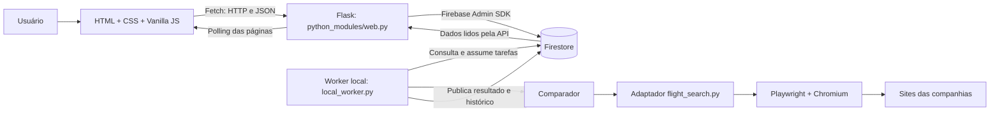
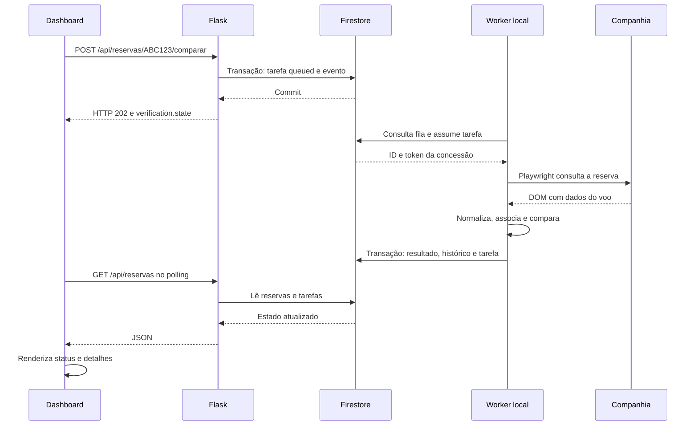
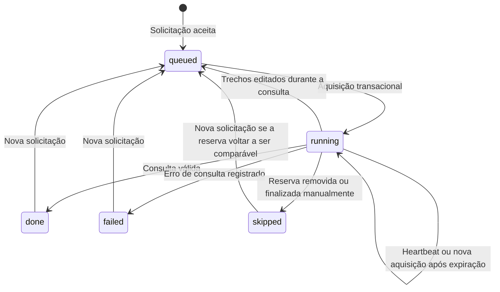

# VeriFLY - Lógica do Projeto

Manual técnico da implementação disponível no repositório em **15 de novembro de 2026**.

Este documento explica o percurso dos dados desde o formulário até a consulta à companhia aérea, a classificação, a persistência e a atualização das telas. A análise acompanha as instruções e funções do código; os blocos relacionados são apresentados em conjunto para facilitar a leitura. As referências a linhas correspondem à versão examinada.

> **Três distinções essenciais:** a regra dos 60 dias usa a **data original de embarque dos trechos alterados**; a sincronização atual das telas usa **polling HTTP**, sem `localStorage`; o `start_worker.ps1` **executa um ambiente previamente preparado**, sem criar a `.venv` ou instalar dependências. As propostas de evolução deste manual estão explicitamente identificadas.

## Sumário

1. [Arquitetura e responsabilidades](#1-arquitetura-e-responsabilidades)
2. [Firestore e modelo de dados](#2-firestore-e-modelo-de-dados)
3. [HTTP, APIs e autenticação](#3-http-apis-e-autenticação)
4. [Fila e worker independente](#4-fila-e-worker-independente)
5. [Automação com Playwright](#5-automação-com-playwright)
6. [Matemática do comparador](#6-matemática-do-comparador)
7. [Front-end e sincronização](#7-front-end-e-sincronização)
8. [Ambiente local e start_worker.ps1](#8-ambiente-local-e-start_workerps1)
9. [Roteiro de leitura do código](#9-roteiro-de-leitura-do-código)
10. [Validação e limites conhecidos](#10-validação-e-limites-conhecidos)

## 1. Arquitetura e responsabilidades

O VeriFLY tem três unidades de execução: o JavaScript no navegador do usuário, a aplicação Flask e um processo Python local dedicado às consultas. O Firestore mantém os dados compartilhados entre elas. Apenas os processos Python acessam o banco diretamente.



### 1.1 Separação de responsabilidades — SoC

**Separation of Concerns**, ou separação de responsabilidades, significa atribuir a cada módulo um conjunto coerente de tarefas. No VeriFLY:

| Camada | Arquivos principais | Responsabilidade |
| --- | --- | --- |
| Entrada | [app.py](app.py) | Expor `app` e iniciar o servidor de desenvolvimento. |
| Transporte HTTP | [web.py](python_modules/web.py) | Rotas, sessão, CSRF, leitura das requisições e respostas. |
| Conexão | [firebase_db.py](python_modules/firebase_db.py) | Inicializar credenciais e cliente Firestore. |
| Regras de negócio | [comparator.py](python_modules/comparator.py) | Interpretar datas, associar trechos, comparar e classificar. |
| Coordenação distribuída | [verification_queue.py](python_modules/verification_queue.py) | Solicitação, exclusão de duplicatas, concessão temporária e publicação. |
| Execução demorada | [local_worker.py](python_modules/local_worker.py) | Consumir tarefas e manter a concessão durante a busca. |
| Adaptação de companhias | [flight_search.py](python_modules/flight_search.py) | Abrir Chromium e selecionar o buscador. |
| Extração | `python_modules/search_scripts/` | Ler os elementos específicos dos sites. |
| Auditoria | [reservation_history.py](python_modules/reservation_history.py) | Gravar eventos e consultar a linha do tempo. |
| Contas e menu | `authentication.py`, `menu_services.py` | Autenticação, pesquisa e notificações. |
| Apresentação | `templates/`, `static/scripts/`, `static/css/` | Estrutura das páginas, estado visual e interação. |

Essa separação permite alterar seletores de uma companhia sem modificar as rotas da API. Também permite hospedar o painel em um servidor sem instalar Playwright nele. Ainda existe acoplamento: o comparador importa `db`, e vários módulos usam esse cliente global. Portanto, a lógica não está inteiramente separada da infraestrutura por interfaces de repositório.

### 1.2 Aplicação multipágina com atualização assíncrona

Uma **SPA — Single-Page Application** normalmente carrega uma página principal e controla a navegação internamente. O VeriFLY entrega páginas diferentes em `/dashboard.html`, `/history.html` e `/new_reserve.html`, renderizadas por Flask/Jinja. Os links do menu fazem navegação HTTP normal.

Dentro de cada página, Fetch e manipulação do DOM atualizam dados sem recarregar todo o documento. A classificação precisa é **aplicação multipágina com comportamento dinâmico no cliente**, usando algumas técnicas também comuns em SPAs.

### 1.3 O que dispara o monitoramento

O botão **Verificar voos agora** solicita uma verificação para cada reserva comparável carregada no Dashboard. O cadastro cria a reserva como `pending`, mas não a enfileira automaticamente. O polling das telas atualiza a exibição; ele também não cria verificações.

Não existe agendador periódico de buscas no código analisado. O worker automatiza a execução das tarefas que chegam à fila. Uma nova consulta depende de uma solicitação, da recuperação de uma execução interrompida ou do reenfileiramento decorrente de edição dos trechos.

## 2. Firestore e modelo de dados

### 2.1 NoSQL orientado a documentos

No Firestore, uma **coleção** contém **documentos**, e cada documento contém campos, mapas e listas. Um documento também pode ter subcoleções. NoSQL, neste contexto, significa que os dados não são modelados como tabelas relacionais com junções SQL e chaves estrangeiras impostas pelo banco.

Isso não elimina a necessidade de esquema: o esquema existe no contrato entre Python, JavaScript e documentos salvos. Tampouco elimina transações: o projeto usa transações para manter reserva, histórico, notificação e fila coerentes.

```text
reservas/{codeReserve}
    historico/{eventId}

verificacoes/{reserveId}
notificacoes/{eventId}

usuarios/{sha256(email_normalizado)}
    estado/notificacoes

sessoes/{sha256(token_da_sessao)}
tentativas_login/{sha256(email_normalizado + "|" + IP)}
```

`reservas/ABC123` e `verificacoes/ABC123` estão associados por convenção de identificador. A aplicação verifica a existência e o estado da reserva; essa relação não é uma chave estrangeira automática.

### 2.2 Documento de reserva

Exemplo ilustrativo de cadastro, usando dados fictícios:

```json
{
  "name": "Passageiro de Exemplo",
  "codeReserve": "ABC123",
  "telefone": "11900000000",
  "folder": "4039",
  "stretches": [
    {
      "order": 1,
      "origin": "CNF",
      "destination": "GRU",
      "type": "domestic",
      "company": "azul",
      "departureOriginal": "2027-01-14T13:30",
      "arrivalOriginal": "2027-01-14T15:00",
      "urlReserve": "https://example.test/reserva/ABC123"
    }
  ]
}
```

| Campo | Tipo/forma | Significado e origem |
| --- | --- | --- |
| `name`, `codeReserve`, `telefone`, `folder` | Strings | Dados do formulário. |
| `stretches` | Lista de mapas | Trechos na ordem coletada no formulário. |
| `order` | Inteiro, iniciando em 1 | Identificação do trecho na apresentação dos resultados. |
| `origin`, `destination` | Strings | Códigos convertidos para maiúsculas pelo front-end. |
| `type` | `domestic` ou `international` | Categoria informativa; não altera o limite de 60 dias. |
| `company` | `azul`, `gol`, `latam` | Companhia escolhida; a disponibilidade no formulário não garante buscador. |
| `departureOriginal`, `arrivalOriginal` | Strings locais ISO | Referência cadastrada; sem offset ou fuso horário. |
| `urlReserve` | String | Link a ser consultado pelo worker. |
| `status` | String | Situação operacional da reserva. |
| `createdAt` | String ISO UTC | Data de criação, preservada no recadastro. |
| `lastCheck` | String ISO sem offset | Momento registrado no início da construção do resultado da consulta. |
| `lastCheckError` | String ou `null` | Falha da última consulta, ou ausência de falha. |
| `segmentResults` | Lista de mapas | Comparação por trecho, incluindo datas consultadas. |
| `previousStatus`, `statusUpdatedAt` | String, string ISO local | Situação anterior e instante da alteração manual. |
| `historyLastAt`, `historyLastType` | String ISO UTC, string | Último evento registrado, usados pelo Histórico. |

O `id` retornado em `GET /api/reservas` é acrescentado a partir de `doc.id`. O campo `verification` também é montado na leitura, a partir de outra coleção; não integra o cadastro original da reserva.

### 2.3 Cadastro e recadastro pelo mesmo localizador

`save_reserve()` usa `codeReserve` como ID e executa `transaction.set(ref, reserve)` sem `merge`. Portanto:

1. Um localizador novo cria um documento e um evento `created`.
2. Um localizador existente substitui o documento principal e gera `updated`.
3. O novo conteúdo aceita apenas os campos superiores `name`, `codeReserve`, `telefone`, `folder` e `stretches` do formulário.
4. O status volta a `pending`; `createdAt` é preservado.
5. Campos de resultado anteriores deixam de existir no documento principal, mas seus snapshots continuam na subcoleção de histórico.

O ID é global na coleção: não inclui companhia nem usuário. Reenviar o mesmo PNR não é rejeitado como duplicidade. O front-end normaliza o localizador para maiúsculas; a API não repete essa normalização nem faz validação profunda de cada trecho.

### 2.4 Dois conjuntos independentes de estados

| `reservas.status` | Significado |
| --- | --- |
| `pending` | Ainda sem classificação de uma verificação concluída. |
| `confirmed` | Sem alteração de embarque detectada segundo as regras de comparação. |
| `high_priority` | Há alteração de embarque e a data original relevante está a até 60 dias. |
| `low_priority` | Há alteração de embarque e a data original relevante está a mais de 60 dias. |
| `solved` | A equipe marcou a alteração como resolvida. |
| `completed` | A equipe marcou a reserva como realizada. |

| `verificacoes.state` | Significado |
| --- | --- |
| `queued` | Aguardando um worker. |
| `running` | Assumida por um worker com concessão temporária. |
| `done` | Resultado concluído e publicado. |
| `failed` | Consulta terminou com erro registrado. |
| `skipped` | Reserva removida ou já fora dos estados comparáveis. |

Uma reserva pode estar `confirmed` e ter uma nova tarefa `running`. Pode manter `high_priority` após uma falha de consulta. O status de negócio e o estado de processamento respondem a perguntas diferentes.

### 2.5 Documento da fila

| Campo | Uso |
| --- | --- |
| `state` | Estado do processamento. |
| `requestedAt` | String ISO UTC da solicitação original da tarefa. |
| `startedAt` | String ISO UTC da última aquisição da tarefa. |
| `finishedAt` | String ISO UTC de finalização, ou `null`. |
| `error` | Mensagem de falha, ou `null`. |
| `token` | UUID em hexadecimal que identifica a aquisição atual. |
| `leaseUntil` | `datetime` UTC persistido como Timestamp do Firestore. |

`public_job()` expõe somente `state`, `requestedAt`, `startedAt`, `finishedAt` e `error`. O token de coordenação e a concessão não são enviados ao navegador. Há um documento por reserva, reutilizado entre verificações; os eventos anteriores pertencem ao histórico.

### 2.6 Histórico transacional

`append_event()` cria um documento em `reservas/{id}/historico` contendo:

```text
type        = created | updated | check_requested | checked | check_failed | status_changed
occurredAt  = instante UTC em ISO 8601
before      = snapshot anterior, ou null na criação
after       = snapshot posterior
```

`history_snapshot()` copia nome, localizador, pasta, telefone, status, resultados e erro. Nos trechos, copia ordem, aeroportos, tipo, companhia e datas originais. A URL da reserva é omitida. É um snapshot selecionado, não uma cópia completa do documento; não há campo de autor da ação.

A mesma transação grava o evento e atualiza `historyLastAt`/`historyLastType` na reserva. Quando aplicável, também cria uma notificação com o ID do evento. O Firestore aplica todas as escritas de uma transação bem-sucedida de forma atômica e pode repetir a função transacional quando há conflito de leitura. [Referência oficial: transações do Firestore](https://firebase.google.com/docs/firestore/manage-data/transactions).

O scraping fica fora dessas transações: segurar uma transação enquanto um site carrega aumentaria a duração e poderia repetir efeitos externos em uma tentativa transacional. O worker calcula o resultado primeiro e valida sua publicação depois.

Essa estrutura oferece **trilha de auditoria**. Não é um sistema de event sourcing completo: a aplicação lê o estado atual da reserva e não o reconstrói a partir dos eventos. Reservas antigas sem eventos continuam visíveis, mas o código não inventa seu passado.

### 2.7 Notificações, contas e sessões

`notificacoes` guarda título, tipo, reserva, nome, localizador, status, mensagem e instante. Cadastro, recadastro e mudança manual geram notificação. Uma consulta com alteração gera alerta quando o status ou os resultados diferem dos anteriores; falhas com a mesma mensagem não geram outro alerta. Os eventos históricos continuam sendo gravados mesmo quando a notificação é suprimida.

`menu_services.py` lê as últimas 50 notificações, complementa alertas de reservas antigas em memória e devolve até 50 itens após ordenar. Os alertas sintéticos usam IDs `legacy-...`. O contador de não lidas refere-se à lista devolvida.

A leitura é salva por usuário em `usuarios/{id}/estado/notificacoes`, no array `readIds`, limitado aos últimos 200 IDs únicos. Assim, persiste entre sessões, mas não constitui armazenamento ilimitado de recibos de leitura.

`usuarios` contém `email`, `name`, `passwordHash`, `enabled`, `passwordVersion`, `createdAt` e `updatedAt`. `sessoes` contém `userId`, `csrfToken`, `passwordVersion` e `expiresAt`, este em segundos desde a época Unix. `tentativas_login` mantém `count` e `windowStart` por combinação de e-mail/IP.

## 3. HTTP, APIs e autenticação

### 3.1 Percurso de uma requisição

1. O navegador chama uma URL relativa, por exemplo `/api/reservas`, usando Fetch.
2. O cookie de sessão acompanha a requisição à mesma origem.
3. `require_session()`, registrado com `@app.before_request`, valida a sessão e, nas alterações, o token CSRF.
4. A função da rota lê parâmetros e delega a operação ao módulo responsável.
5. O backend acessa o Firestore pelo Firebase Admin SDK.
6. `jsonify()` transforma o resultado em JSON e o Flask devolve o código HTTP.
7. O JavaScript confere `response.ok`, lê o corpo e atualiza seu estado e o DOM.

O contrato HTTP é entre navegador e Flask. O navegador não usa o SDK web do Firebase, e os módulos Python não chamam as rotas Flask para acessar o banco: usam o cliente Firestore diretamente.

A API adota recursos e métodos comuns ao estilo REST: `GET` lê, `POST` cria ou solicita uma ação e `PATCH` altera parcialmente um recurso. Há características próprias, como `/comparar` representar um comando e `POST /api/reservas` também substituir um cadastro existente. As sessões são persistidas no servidor; não se trata de uma implementação estrita de todos os princípios de REST.

### 3.2 Contratos das rotas

Todas as APIs abaixo exigem sessão, exceto o envio de login. Operações de escrita autenticadas exigem `X-CSRF-Token`.

| Método e caminho | Entrada | Resposta principal |
| --- | --- | --- |
| `POST /api/auth/login` | Formulário ou JSON com `email`, `password`, `csrf_token`, `next`; desafio opcional | `200`, `{"redirect": "/dashboard.html"}` e cookie. |
| `GET /api/auth/me` | Cookie | `200`, `user` público e `csrfToken`. |
| `POST /api/auth/logout` | Cabeçalho CSRF | `200`, revogação da sessão e `redirect`. |
| `POST /api/reservas` | JSON de cadastro | `201`, `{"status":"ok","id":"ABC123"}`, inclusive no recadastro. |
| `GET /api/reservas` | Sem parâmetros implementados | `200`, array de todas as reservas com `id` e `verification`. |
| `POST /api/reservas/{id}/comparar` | Sem corpo obrigatório | `202`, reserva e estado público da solicitação. |
| `PATCH /api/reservas/{id}/status` | `{"status":"solved"}` ou `{"status":"completed"}` | `200`, reserva atualizada. |
| `GET /api/reservas/{id}/historico` | `limit` opcional entre 1 e 100; padrão 25; `cursor` opcional | `200`, `reserve`, `events`, `nextCursor`. |
| `GET /api/pesquisa?q=...` | Consulta truncada a 120 caracteres pela rota | `200`, `results`, com até oito sugestões. |
| `GET /api/notificacoes` | Sessão identifica o usuário | `200`, `notifications` e `unreadCount`. |
| `POST /api/notificacoes/lidas` | `{"ids":["..."]}`, até 50 IDs válidos | `200`, `{"status":"ok"}`. |

Erros previstos incluem `400` para dados/ações inválidos, `401` para sessão ausente ou credenciais incorretas, `403` para CSRF inválido e `404` para reserva inexistente nas rotas que a consultam. O login pode retornar `429` com `Retry-After`, ou `503` se somente uma das chaves do Turnstile estiver configurada. JSON malformado ou tipo de conteúdo inadequado também pode ser rejeitado pelo Flask antes da regra de negócio.

O limite de corpo configurado é `1024 * 1024` bytes. Não existe endpoint de exclusão de reserva nem endpoint específico para editar seus campos.

### 3.3 Por que o comparador responde 202

`202 Accepted` informa que a solicitação foi aceita para processamento. A resposta não significa que o navegador automatizado já consultou a companhia, nem que a consulta terá sucesso.



Uma solicitação para `solved` ou `completed` também retorna `202`, mas `request_check()` não cria nova tarefa. A resposta representa o comportamento idempotente e protegido da rota, não a garantia de execução para qualquer estado.

### 3.4 Autenticação implementada pelo projeto

O uso de Firebase não significa uso de Firebase Authentication. O projeto implementa contas e sessões em `authentication.py`, usando Firestore como persistência.

O cadastro administrativo usa `python -m python_modules.create_user`. O e-mail é normalizado, a senha deve ter de 12 a 256 caracteres e é armazenada com `generate_password_hash()` do Werkzeug. O algoritmo padrão utilizado é scrypt; o código delega a escolha padrão à biblioteca.

No login, o token do formulário deve coincidir com o cookie `verifly_login_csrf`. O controle de tentativas permite cinco tentativas por e-mail/IP dentro de uma janela de 15 minutos; uma tentativa posterior é bloqueada enquanto a janela estiver ativa. O sucesso remove o registro de tentativas. A resposta para senha errada e conta desconhecida é a mesma, e um hash fictício é verificado quando não há hash de usuário.

Uma autenticação válida gera token aleatório de sessão. Seu hash SHA-256 é usado como ID do documento; o token original vai no cookie `verifly_session`, com `HttpOnly`, `SameSite=Lax` e duração de oito horas. `Secure` depende de `VERIFLY_COOKIE_SECURE=1` ou da requisição reconhecida como HTTPS.

Cada acesso privado relê sessão e usuário, verificando expiração, `enabled` e `passwordVersion`. Redefinir a senha troca essa versão e invalida sessões anteriores. Logout exclui a sessão. A expiração é verificada na leitura; não há rotina de limpeza de documentos expirados no código.

O token CSRF de sessão é devolvido por `/api/auth/me` e mantido em memória pelo JavaScript. O wrapper `window.Verifly.fetch` o injeta nas escritas. Não há autenticação, token CSRF ou credencial Firebase armazenados em `localStorage` pela implementação atual.

O acesso às reservas é compartilhado pelas contas autenticadas: as rotas não filtram por proprietário, organização ou perfil de autorização. Respostas não estáticas recebem `Cache-Control: no-store`, `nosniff`, `Referrer-Policy: same-origin` e `X-Frame-Options: SAMEORIGIN`.

## 4. Fila e worker independente

### 4.1 Conceito de fila neste projeto

Uma fila separa quem **solicita** trabalho de quem o **executa**. O produtor é a API; o consumidor é o worker. A tarefa persiste no Firestore, permitindo que a API responda sem aguardar a navegação externa.

A implementação é uma coleção consultada por polling, sem Celery, Redis ou RabbitMQ. Também não é uma fila FIFO estrita: `claim_next()` consulta primeiro `queued`, depois `running`, sem `order_by(requestedAt)`. Tarefas abandonadas podem esperar enquanto houver tarefas novas elegíveis.

### 4.2 Solicitação e deduplicação

`request_check(reserve_id)` lê reserva e tarefa na mesma transação. Se a reserva não existe, lança `LookupError`. Se estiver em `pending`, `confirmed`, `high_priority` ou `low_priority`, uma tarefa nova pode ser gravada.

Quando a tarefa já está `queued` ou `running`, ela é reutilizada. Cliques repetidos não criam vários documentos nem novos eventos de solicitação para a mesma execução. Estados terminais permitem uma nova solicitação, que substitui o documento da tarefa por `state`, `requestedAt` e `error`.

### 4.3 Aquisição atômica e lease

**Lease** é uma concessão temporária de processamento. `_claim()` relê a candidata dentro de uma transação e aceita:

```text
state == queued
OU
state == running E leaseUntil <= agora_UTC
```

Ao aceitar, gera `token = uuid4().hex`, muda o estado para `running` e define:

```text
leaseUntil = agora_UTC + 300 segundos
```

Dois workers podem encontrar o mesmo documento na consulta inicial. A releitura transacional decide qual aquisição é válida. O token distingue uma execução anterior de uma aquisição mais recente.

### 4.4 Heartbeat e execução sequencial

`process_check()` inicia uma thread daemon de heartbeat. A cada 30 segundos ela chama `renew_lease(id, token)`. A renovação só ocorre se o token continuar correspondente e o estado for `running`; então o vencimento avança mais 300 segundos a partir da renovação.

A thread principal lê a reserva e executa `build_comparison_update()`. Ao terminar, chama `finish_check()`. Em `finally`, sinaliza a parada do heartbeat e aguarda sua thread por até dois segundos.

O heartbeat é concorrente com o scraping, mas cada processo de worker consulta **uma reserva por vez**. A thread não é um conjunto de consumidores paralelos. É possível iniciar mais processos; as transações coordenam as aquisições.

### 4.5 Publicação protegida

`finish_check()` lê novamente tarefa e reserva antes de escrever:

| Condição encontrada | Comportamento |
| --- | --- |
| Token divergente ou tarefa fora de `running` | Retorna `False`, sem publicar o resultado antigo. |
| Reserva não existe ou está fora dos estados comparáveis | Finaliza a tarefa como `skipped`. |
| `stretches` atuais diferem dos consultados | Volta a tarefa para `queued`, limpa token/erro e descarta o resultado. |
| Resultado contém `lastCheckError` | Publica dados de falha e finaliza como `failed`. |
| Resultado válido | Atualiza a reserva e finaliza como `done`. |

Quando há atualização da reserva, resultado, evento de histórico, metadados, eventual notificação e finalização da tarefa são coordenados pela transação. O teste de edição cobre o array inteiro de trechos, incluindo URLs; não usa uma versão geral da reserva.

O vencimento do lease permite nova aquisição, mas `finish_check()` verifica token/estado, sem comparar diretamente `leaseUntil`. Um worker que terminou depois do vencimento ainda pode publicar se ninguém tiver assumido a tarefa com outro token. Se outro worker já assumiu, seu token impede a publicação antiga.



### 4.6 Retentativas e interrupções

Existem mecanismos diferentes, que não devem ser confundidos:

| Nível | Recuperação implementada |
| --- | --- |
| Scraper da companhia | Tentativas locais de navegação/extração; detalhes na seção 5. |
| Firestore | Reexecução da função transacional em conflitos, gerenciada pela biblioteca. |
| Processo do worker | Falha de infraestrutura é registrada em log; a concessão deixa de ser renovada. |
| Fila | Outro ciclo pode recuperar `running` com lease vencido. |
| Falha terminal de consulta | Permanece `failed` até uma nova solicitação; não é automaticamente selecionada por `claim_next()`. |

Uma falha ao ler ou publicar no banco não é convertida indiscriminadamente em falha terminal. `process_check()` registra a exceção, encerra o heartbeat e deixa a tarefa recuperável pela expiração. Ao perder a concessão, o heartbeat para, mas não cancela ativamente o navegador; a proteção final é a validação do token.

A execução tem possibilidade de repetição após interrupções, próxima de uma semântica **pelo menos uma vez**. Não há garantia de que a companhia será acessada exatamente uma vez; a publicação obsoleta é que é rejeitada.

### 4.7 Laço principal e independência da API

`main()` define intervalo padrão de cinco segundos. Quando encontra trabalho, processa e volta imediatamente a procurar outro. O `sleep` ocorre quando não há tarefa disponível ou após erro de consulta da fila.

`--once` processa enquanto houver tarefa adquirível e encerra quando não encontrar outra. Não significa “uma única reserva” nem uma fotografia imutável da fila: tarefas que chegarem durante o processamento também podem ser consumidas. Uma tarefa `running` com lease ainda válido não é aguardada nesse modo.

O Flask importa o comparador para ações manuais, mas `flight_search` só é importado dentro de `build_comparison_update()`. A rota `/comparar` chama `request_check()`. Assim, os waits síncronos do Playwright ocupam o processo local e não o atendimento HTTP do Flask. A API ainda depende do tempo das suas próprias operações no Firestore; não há promessa de resposta instantânea.

O termo **background worker** descreve sua função arquitetural. O script PowerShell inicia o processo em primeiro plano no terminal e aguarda seu encerramento; ele não instala um serviço do Windows nem inicia uma tarefa agendada.

## 5. Automação com Playwright

### 5.1 Adaptador e ciclo de vida do navegador

`flight_search.search_flight(url, company, reserve=None)` é o ponto de entrada usado pelo comparador. O argumento `reserve` está disponível na assinatura, mas não é utilizado pelo adaptador atual.

O fluxo das linhas 54–73 de [flight_search.py](python_modules/flight_search.py) é:

1. `_load_scrapers()` importa o bloqueador de recursos e os buscadores de Azul/GOL.
2. O nome da companhia é convertido para minúsculas e procurado no dicionário de buscadores.
3. Uma companhia sem implementação gera `NotImplementedError`.
4. `with sync_playwright()` inicia o controlador do Playwright.
5. `pw.chromium.launch(headless=HEADLESS)` abre um processo Chromium.
6. `browser.new_context(reduced_motion="reduce")` cria um contexto de navegação para aquela consulta.
7. `context.route("**/*", block_resources)` registra a interceptação de rede antes da navegação.
8. `_run_scraper()` chama a função específica e retorna seu dicionário.
9. `finally: browser.close()` fecha o navegador, inclusive se a extração lançar exceção após sua abertura.

**Browser** é o processo do navegador; **context** é um ambiente de navegação separado; **page** representa uma aba. Há um navegador/contexto novo por chamada a `search_flight()`, e uma página nova por tentativa dentro do scraper. Esse desenho favorece isolamento, com custo de inicialização a cada reserva. Não existe pool de navegadores.

`_run_scraper()` usa `inspect.signature()` para adaptar assinaturas: Azul recebe `(context, url)`; GOL recebe `(0, context, url)` porque declara `index_reserve`. Esse índice é usado para saída no terminal, não para selecionar um documento da fila.

O código usa a API **síncrona** do Playwright. `goto()`, leitura de elementos e espera de seletor bloqueiam o fluxo Python que os executa. A separação em outro processo é o que protege a API web dessa demora.

### 5.2 Headless, navegação e prontidão do conteúdo

`headless=True` executa o navegador sem janela visível. Ainda há Chromium executando HTML, JavaScript e requisições; não é apenas um download textual com um cliente HTTP.

O adaptador lê `VERIFLY_HEADLESS` ao ser importado: qualquer valor diferente de `"0"` ativa headless, com padrão `"1"`. Já o worker executa `os.environ.setdefault("VERIFLY_HEADLESS", "0")` antes de importar a fila, favorecendo janela visível quando iniciado diretamente sem variável definida. O PowerShell controla explicitamente esse valor, como explicado na seção 8.

Os scrapers navegam com `wait_until="domcontentloaded"`. Esse marco indica que o documento foi analisado pelo navegador; não comprova que todos os dados carregados posteriormente por JavaScript já chegaram.

Na GOL há uma espera explícita por `.m-home-flight-card__container`, com `timeout=100000`, isto é, 100 segundos. Isso é o limite dessa espera específica, não o limite total da verificação. A Azul não tem espera explícita equivalente antes da contagem dos trechos. Esperas internas de operações de elementos não substituem uma condição completa de prontidão do itinerário.

### 5.3 Contrato de saída dos scrapers

```json
{
  "locator": "ABC123",
  "outbound_flight_infos": {
    "origin": {"airport": "CNF", "date": "14/01/2027", "hour": "14:25"},
    "destiny": {"airport": "GRU", "date": "14/01/2027", "hour": "15:55"}
  }
}
```

`return_flight_infos` aparece nas reservas interpretadas como ida e volta. A chave `destiny`, embora diferente do nome `destination` do cadastro, faz parte do contrato atual. O comparador adapta esses nomes.

O `locator` extraído é devolvido, mas o comparador não o confronta com `codeReserve`. A associação dos dados depende da URL escolhida e dos trechos extraídos.

### 5.4 Azul: seletores e tentativas

Em [search_flights_azul.py](python_modules/search_scripts/azul/search_flights_azul.py):

| Linhas | Operação |
| --- | --- |
| 1–6 | `MAX_ATTEMPTS = 6` e `range(1, 6, 1)`: valores 1, 2, 3, 4 e 5. |
| 9–16 | Limpa cookies, cria a página e navega. |
| 18–21 | Aceita o aviso de cookies se estiver visível naquele momento. |
| 23–30 | Localiza `div.regular`, conta filhos diretos e escolhe ramo de ida ou ida/volta. |
| 32–83 | Lê localizador, aeroportos e elementos `time` por posições `nth()`. |
| 88–90 | Fecha a página e retorna os dados no sucesso. |
| 92–136 | Captura exceções, fecha a página e tenta de novo; na quinta tentativa devolve a estrutura com valores `None`. |

As posições fixas pressupõem uma determinada estrutura do DOM da companhia. Por exemplo, o destino da ida usa `time.nth(2)` no campo `date` e `time.nth(3)` no campo `hour`; o parser tolera inversão entre texto de data e texto de hora. Isso não corrige um índice que extraia informação de outro voo.

### 5.5 GOL: limite efetivo de uma tentativa

Em [search_flights_gol.py](python_modules/search_scripts/gol/search_flights_gol.py), `MAX_ATTEMPTS = 2`, `STOP = 1` e o laço é `range(1, 2, 1)`. Portanto, há **uma tentativa total**, sem segunda tentativa após erro. O comentário sobre cinco tentativas não corresponde à execução.

O scraper limpa cookies, abre a página, tenta aceitar cookies e fechar um modal, aguarda o contêiner e usa `#itinenary-0` e `#itinenary-1` para os itinerários. Dentro deles, seleciona códigos, datas e horas por classes e índices. Na exceção, retorna a estrutura com `None` já na primeira passagem.

Nos dois buscadores, limpar cookies não limpa todo o estado do contexto, como armazenamento local do site. As páginas são recriadas dentro do mesmo contexto daquela reserva.

### 5.6 Bloqueio de recursos de rede

[block_resources.py](python_modules/search_scripts/block_resources.py) contém a política:

```python
blocked_types = ["image", "stylesheet", "font", "media"]
if route.request.resource_type in blocked_types:
    route.abort()
else:
    route.continue_()
```

| Tipo | Decisão | Razão no fluxo de extração |
| --- | --- | --- |
| Imagem | Bloquear | Fotos e ícones não compõem os textos consultados. |
| Stylesheet | Bloquear | Reduz download de aparência da página. |
| Fonte | Bloquear | Tipografia não é necessária para ler texto. |
| Mídia | Bloquear | Áudio/vídeo não participa da consulta. |
| Documento, script, XHR/fetch e demais tipos | Permitir | Preserva HTML, execução da aplicação e carregamento de dados. |

Essa interceptação é por tipo de recurso, não por domínio ou lista de anúncios. `reduced_motion="reduce"` solicita redução de movimento ao site; não é bloqueio de tráfego.

O Playwright oferece interceptação no contexto com `route()`. Requisições controladas por Service Workers podem exigir tratamento adicional; o VeriFLY não configura `service_workers="block"`. [Referência oficial: rede no Playwright](https://playwright.dev/python/docs/network).

Bloquear CSS reduz tráfego, mas pode mudar condições de visibilidade usadas por cliques e seletores. O ganho de desempenho não foi medido no repositório; a configuração deve ser entendida como estratégia de redução de recursos, não como garantia de compatibilidade ou percentual fixo de aceleração.

### 5.7 Resiliência e limitações reais

Não existem backoff exponencial, jitter, política por tipo de exceção ou circuit breaker nos scrapers. As tentativas são imediatas, descontado o tempo gasto nas próprias operações e timeouts.

Os blocos `except Exception` capturam amplamente erros de navegação, extração e programação. O retorno totalmente vazio resulta em `A busca não retornou dados de voo` no comparador. Isso preserva o status anterior, mas a causa específica do scraper pode ficar apenas no terminal.

Há um limite de robustez na limpeza: se o erro ocorrer antes de `page` ser atribuído, `page.close()` no `except` pode gerar outra exceção. O `finally` do adaptador ainda fecha o navegador que já tiver sido aberto. Uma evolução seria inicializar `page = None` e concentrar sua limpeza em `finally`, mas isso não está implementado.

O import de `flight_search` em `build_comparison_update()` ocorre **antes** do `try` da função. Falta do pacote Playwright, por exemplo, pode escapar como erro de processamento do worker e deixar a tarefa para recuperação após o lease, em vez de produzir `lastCheckError`. Erros de lançamento do navegador durante `search_flight()`, por sua vez, ficam dentro do `try` do comparador.

A LATAM aparece no formulário, mas não consta no dicionário de buscadores. O arquivo em `search_scripts/latam/` ainda contém uma função com nome e lógica da Azul e não integra o fluxo ativo. `search_scripts/search.py` também é um caminho auxiliar antigo, com lista global e chamada direta à Azul; o worker usa `flight_search.py`.

## 6. Matemática do comparador

### 6.1 Visão do algoritmo completo

`build_comparison_update(reserve)`:

1. Obtém `stretches` e escolhe a primeira URL preenchida.
2. Usa a companhia do **primeiro trecho**, mesmo que a URL tenha vindo de outro.
3. Registra `lastCheck` antes da navegação.
4. Consulta a companhia uma única vez por reserva.
5. Extrai até os dois blocos previstos pelo contrato: ida e volta.
6. Associa os blocos aos trechos cadastrados.
7. Compara separadamente embarque e chegada.
8. Verifica se há trechos ausentes e se há alterações.
9. Calcula o status e monta a atualização; em erro, monta `lastCheckError`.

Essa estratégia pressupõe que uma URL e uma companhia representem a reserva. O formulário permite vários trechos e companhias, mas o algoritmo atual não faz buscas independentes para cada combinação.

### 6.2 Normalização da referência cadastrada

`parse_saved_datetime("2027-01-14T13:30")` devolve:

```text
(date(2027, 1, 14), "13:30")
```

O texto é separado no primeiro `T`. A data é validada por `datetime.strptime(..., "%Y-%m-%d")`, e a hora é recortada para os primeiros cinco caracteres. Sem hora, o retorno é `(data, None)`; sem valor ou com data inválida, `(None, None)`.

A hora não passa por validação rigorosa de faixa nessa função. Segundos e informações adicionais não participam da comparação.

### 6.3 Normalização dos dados da companhia

`parse_company_datetime(date_text, hour_text)` concatena os dois textos, remove acentos e converte para minúsculas. Por isso consegue reconhecer data e hora mesmo quando vierem trocadas nas chaves.

| Texto de entrada | Interpretação |
| --- | --- |
| `14/01/2027`, `14/01/27` | Ano 2027, mês 1, dia 14. |
| `2027-01-14` | Ano 2027, mês 1, dia 14. |
| `14/01` | Ano ausente, mês 1, dia 14. |
| `14 de janeiro de 2027` | Mês reconhecido pelo prefixo `jan`. |
| `qui, 14 jan` | Ano ausente, mês 1, dia 14. |
| `6:10` | Hora normalizada como `06:10`. |
| `12h55` | Hora normalizada como `12:55`. |

A procura de data prioriza ISO, depois formato numérico e depois textual. Anos numéricos menores que 100 recebem `+2000`. A hora é reconhecida por expressão regular, também sem validação completa de `00–23` e `00–59`. As datas impossíveis serão rejeitadas ao construir o objeto `date`.

### 6.4 Como o ano ausente é resolvido

Se a companhia fornece dia e mês, `resolve_day()` considera os anos da data original de referência menos um, igual e mais um. Entre datas válidas, escolhe a mais próxima da referência:

```text
R = data original de referência
C = {date(ano(R) - 1, mês, dia),
     date(ano(R),     mês, dia),
     date(ano(R) + 1, mês, dia)} com datas inválidas removidas

data resolvida = argmin, para c em C, de |c - R| em dias
```

Exemplo: para referência `31/12/2026` e retorno `01/01`, as candidatas são `01/01/2025`, `01/01/2026` e `01/01/2027`. A escolha é `01/01/2027`, a um dia da referência.

Se o ano vier explícito, apenas ele é usado. Sem referência nem ano, tenta o ano atual do processo. Em empate, a primeira candidata na ordem dos anos é mantida. A chegada usa sua própria data original como referência; na ausência dela, usa a partida original. Não há algoritmo adicional para impor duração positiva de viagem ou ajustar fusos.

### 6.5 Associação entre trechos

`extract_company_legs()` normaliza origem/destino e interpreta datas. Um bloco sem informação reconhecível de data de partida é descartado. `clean_airport()` procura a primeira palavra de três letras no texto em maiúsculas: é uma heurística, não uma consulta a um catálogo IATA.

`match_legs()` cria uma lista inicialmente preenchida com `None` e controla os voos já usados em um `set`. Executa três passagens:

1. Origem e destino iguais aos cadastrados.
2. Para os não associados, apenas origem igual.
3. Se as listas têm o mesmo tamanho, tenta o mesmo índice, desde que esse índice de voo ainda não tenha sido usado.

Cada voo consultado só pode ser associado uma vez. O fallback por posição não garante associação completa quando passagens anteriores consumiram índices cruzados. Não há casamento por número de voo, data, companhia ou busca da melhor combinação global.

Aeroportos ajudam a associar os trechos, mas mudanças de rota não são adicionadas a `changedFields`: a classificação considera apenas data e hora da partida associada.

### 6.6 Equações da alteração de embarque

Para um trecho `i`, defina:

```text
D0_i = data de partida cadastrada
H0_i = hora de partida cadastrada
D1_i = data de partida consultada e resolvida
H1_i = hora de partida consultada

mudou_data_i = (D0_i != D1_i)
mudou_hora_i = H0_i existe E H1_i existe E (H0_i != H1_i)
mudou_embarque_i = mudou_data_i OU mudou_hora_i
```

Sem voo associado, sem data original válida ou sem data consultada resolvível, o resultado é `not_found`. Nos demais casos, `changedFields` recebe `date` e/ou `hour`, e o status do trecho é `changed` se essa lista não estiver vazia; caso contrário, `same`.

Não há margem de tolerância: uma diferença reconhecida de um minuto já altera o embarque. Contudo, a ausência de hora em um dos lados não é tratada como diferença nem torna o trecho `not_found`. Assim, `same` significa igualdade nos componentes efetivamente comparados, não prova de igualdade de todos os horários possíveis.

A comparação sempre parte de `departureOriginal` e `arrivalOriginal`, não do último horário consultado em `segmentResults`. Se uma companhia mantiver a mesma alteração em verificações sucessivas, ela continuará sendo uma alteração em relação ao cadastro. Uma falha posterior preserva o status e os resultados anteriores no documento principal, acrescentando o novo `lastCheckError`; esses resultados antigos não devem ser interpretados como uma leitura bem-sucedida da tentativa que falhou.

### 6.7 Equações da chegada

Com `A0_i`/`A1_i` como datas de chegada e `J0_i`/`J1_i` como horas:

```text
arrivalChanged_i =
    (A0_i != A1_i)
    OU
    (J0_i existe E J1_i existe E J0_i != J1_i)
```

A expressão só é calculada quando as duas datas de chegada existem. Caso contrário, `arrivalChanged` fica `None`, que vira `null` no JSON. Uma falha anterior na comparação da partida retorna antes de comparar a chegada.

Os três estados informativos são `true` — mudou, `false` — não mudou nos dados comparados, e `null` — não conferido. A chegada não acrescenta itens a `changedFields`, não torna o trecho `changed` e não participa da prioridade de 60 dias.

Portanto, uma reserva pode ficar `confirmed` e exibir alteração de chegada nos detalhes. O rótulo geral deve ser interpretado à luz dessa regra.

### 6.8 Regra exata dos 60 dias

Considere o conjunto de trechos com **embarque alterado**:

```text
C = {i | status do trecho i == changed}
T = data atual obtida por date.today(), ou today passado explicitamente
```

Se `C` não estiver vazio:

```text
D_min = mínimo de D0_i para i em C
delta_dias = (D_min - T).days

prioridade = high_priority, se delta_dias <= 60
             low_priority, se delta_dias > 60
```

Se `C` estiver vazio, `classify()` devolve `confirmed`. Antes dessa chamada, `build_comparison_update()` impede que uma consulta com trechos ausentes e nenhuma alteração seja confirmada: nesse cenário, registra erro e mantém a situação anterior.

| Situação dos resultados | Resultado do fluxo completo |
| --- | --- |
| Nenhum bloco de voo aproveitável | Erro; status preservado. |
| Há `not_found`, mas nenhum `changed` | Erro; status preservado. |
| Todos conferidos, nenhum `changed` | `confirmed`. |
| Há `changed`, sem ausências | Alta ou baixa prioridade pela equação. |
| Há `changed` e também `not_found` | Alta ou baixa prioridade pelos alterados; os ausentes permanecem explicitados em `segmentResults`. |

**A data é a original cadastrada, não a nova data da companhia.** **A contagem usa dias de calendário, não períodos de 24 horas até o horário do voo.** **A seleção considera somente trechos alterados.** O tipo doméstico/internacional não modifica a fórmula.

### 6.9 Exemplos calculados

Adotando `T = 15/11/2026`, sempre com alteração reconhecida no embarque:

| Partida original relevante | Diferença em dias | Classificação |
| --- | ---: | --- |
| 13/01/2027 às 23:59 | 59 | `high_priority` |
| 14/01/2027 às 00:01 | 60 | `high_priority` |
| 14/01/2027 às 23:59 | 60 | `high_priority` |
| 15/01/2027 às 00:01 | 61 | `low_priority` |
| 15/11/2026 em qualquer horário | 0 | `high_priority` |
| 14/11/2026 | -1 | `high_priority` |

O código não exige `0 <= delta_dias`. Assim, embarques passados alterados também entram em alta prioridade. `completed` depende de ação manual, não da passagem do horário.

Outros casos importantes:

| Caso | Consequência |
| --- | --- |
| Original a 61 dias, antecipado pela companhia para 30 dias | Baixa prioridade, pois a base continua original. |
| Original a 30 dias, adiado pela companhia para 90 dias | Alta prioridade. |
| Ida inalterada a 10 dias e volta alterada a 70 dias | Baixa prioridade; a ida não integra `C`. |
| Dois trechos alterados a 70 e 40 dias | Alta prioridade, pois `min(70, 40) = 40`. |
| Apenas chegada alterada, partida igual | `confirmed`, com aviso de chegada no detalhe. |
| Horário cadastrado, hora consultada ausente, data igual | Trecho `same`, segundo a comparação disponível. |

### 6.10 Em que sentido a regra é dinâmica

`date.today()` é lido a cada classificação. Um embarque original de `15/01/2027` está a 61 dias em `15/11/2026` e a 60 dias em `16/11/2026`. Uma **nova comparação válida** muda a prioridade de baixa para alta.

Porém, `GET /api/reservas` apenas lê o status salvo. O polling, a atualização da contagem visual e a virada da meia-noite não executam `classify()`. Uma reserva pode manter baixa prioridade até a próxima consulta bem-sucedida, mesmo depois de entrar na janela de 60 dias.

Não existe fuso de negócio configurado: o processo que classifica usa sua data local. A fila e o histórico usam UTC, enquanto `lastCheck`/`statusUpdatedAt` usam `datetime.now()` sem offset. O navegador também usa seu próprio fuso para certos cálculos visuais. Essas escolhas podem divergir perto da meia-noite.

Uma evolução possível seria separar atualização de prioridade e scraping, definir um fuso de negócio e agendar a reclassificação diária. Isso alteraria o comportamento atual e requereria uma decisão explícita sobre datas originais versus novas datas.

### 6.11 Diferença de horário exibida no Dashboard

`formatDelta()` calcula uma diferença informativa usando objetos `Date` locais do navegador:

```text
delta_minutos = round((instante_novo - instante_original) / 60000)
```

Se algum lado não tiver `T`, a função compara somente as datas, usando meia-noite para ambos. Diferenças menores que 120 minutos são mostradas em minutos; a partir daí:

```text
dias    = floor(abs(delta_minutos) / 1440)
horas   = floor((abs(delta_minutos) % 1440) / 60)
minutos = abs(delta_minutos) % 60
```

Exemplos: `+55min`, `-1d`, `+2h 5min`. Isso descreve o deslocamento observado; não participa do cálculo de prioridade.

`daysUntil()` zera hora/minuto/segundo de hoje e da partida do primeiro trecho e calcula `round((destino - hoje) / 86400000)`. O texto `(60 dias)` da tabela pode se referir a um trecho diferente daquele que determinou a prioridade, porque `classify()` seleciona o menor embarque original entre os **alterados**.

### 6.12 Status manual e preservação da referência

`set_manual_status()` permite `solved` apenas a partir de alta/baixa prioridade. Permite `completed` a partir de qualquer status diferente de `completed`, sem conferir se a data já passou. Salva `previousStatus`, `statusUpdatedAt` e o evento de alteração.

Esses estados saem de `COMPARABLE_STATUS` e são protegidos contra resultados tardios. Marcar `solved` não copia `newDeparture` para `departureOriginal`, nem altera o bilhete na companhia. É uma marcação operacional da equipe. Não há rota de reabertura; o recadastro é uma operação distinta que redefine o documento para `pending`.

## 7. Front-end e sincronização

### 7.1 Templates, componentes e DOM

Os templates internos incluem `_top_menu.html` com Jinja. O Histórico configura o campo compartilhado como `history-search`; Nova Reserva oculta a pesquisa. Cada página carrega `top_menu.js` antes do script específico, garantindo a criação de `window.Verifly` antes das chamadas de API.

O CSS está separado em variáveis, componentes e páginas. `variables.css` define cores; `menu.css` organiza o contêiner em Grid; `top_menu.css` adapta cabeçalho e painéis; as folhas de páginas controlam cards, formulário e histórico. Há Flexbox, Grid, seletores aninhados e media queries. O Histórico também importa o CSS do Bootstrap pelo CDN, sem usar Bootstrap como estrutura de estado JavaScript. O nome existente `dasboard.css`, sem o segundo `h`, é o nome usado pelo template.

O DOM é atualizado diretamente com `innerHTML`, `textContent`, `classList` e criação de elementos. Não há React, Vue ou virtual DOM. Os scripts mantêm arrays, `Set` e `Map` em memória para conservar estado entre renderizações.

### 7.2 Fetch, Promises e async/await

Uma chamada Fetch devolve uma **Promise**, que representa um resultado futuro. `await` suspende a continuação daquela função assíncrona enquanto a operação está pendente, permitindo que o navegador continue tratando eventos. Isso não cria uma thread Python nem torna o backend automaticamente assíncrono.

Há duas esperas separadas: receber a resposta HTTP e consumir seu corpo com `response.json()`. Os scripts também verificam `response.ok`, porque uma resposta HTTP de erro precisa ser tratada pela aplicação.

`top_menu.js` centraliza o acesso:

```text
ready = Promise da consulta inicial a GET /api/auth/me

window.Verifly.fetch(url, options):
    aguarda ready
    constrói os headers
    acrescenta X-CSRF-Token em operações de escrita
    chama o fetch original com cache: no-store
    redireciona ao login se receber 401
    devolve Response para a página tratar
```

Todas as chamadas privadas de uma página aguardam a mesma Promise de inicialização. Se ela falhar, o wrapper não cria por conta própria uma nova autenticação; a interface orienta atualizar a página. O login tem fluxo separado, com `fetch` nativo e `FormData`, pois ainda não existe sessão privada.

### 7.3 Cadastro dinâmico de trechos

`new_reserve.js` clona o primeiro bloco `.segment`, limpa inputs, reseta selects e adiciona o botão de remoção. `updateSegments()` renumera os trechos, e o primeiro é mantido obrigatório.

Listeners no contêiner usam **delegação de eventos**: o clique ou input sobe pelo DOM, e `closest()` identifica o trecho/botão. Assim, os elementos clonados funcionam sem reinstalar todos os listeners individualmente.

A validação compara strings `datetime-local`: no formato `YYYY-MM-DDTHH:MM`, a ordem textual acompanha a ordem cronológica local. Se a chegada for menor que a partida, `setCustomValidity()` bloqueia o envio normal do formulário.

Essa validação usa horários locais sem fusos, inclusive quando o tipo é internacional. Também é validação do cliente: a API verifica campos básicos e a presença de trechos, mas não reproduz toda a validação do formulário.

No envio, `preventDefault()` evita navegação, os dados são serializados em JSON e o botão é desabilitado. Com sucesso, o formulário é limpo; em `finally`, o botão volta ao estado disponível. O texto “Cadastrar e Monitorar” não corresponde a um enfileiramento automático no backend.

### 7.4 Estado e renderização do Dashboard

O Dashboard mantém:

```text
reserves     = array recebido da API
activeFilter = status selecionado, ou null
expanded     = Set de IDs com detalhes abertos
```

`loadReserves()` busca os dados e chama `render()`. `renderCounters()` conta todas as reservas por status; `renderTable()` aplica o filtro ativo e a busca normalizada, depois ordena por prioridade e partida original do primeiro trecho.

Os contadores do Dashboard não seguem o filtro textual; os do Histórico seguem a lista filtrada. As linhas abertas sobrevivem às atualizações porque seus IDs ficam em `expanded`, fora do HTML reconstruído.

`changeStatus()` pede confirmação na própria interface, faz `PATCH`, substitui a reserva local pela resposta e renderiza. A atualização visual ocorre após sucesso do servidor. O polling seguinte também recompõe campos associados, como `verification`, que não são necessariamente devolvidos pela ação manual.

No botão de verificação geral, `targets` contém todas as reservas comparáveis carregadas, independentemente do filtro visível. O laço envia um `POST` por vez, exibe progresso de **solicitação**, atualiza o item devolvido e contabiliza falhas. O botão é reativado ao fim do enfileiramento; ele não espera que o worker termine as consultas.

### 7.5 Polling implementado nas telas

Polling é a consulta periódica ao servidor para descobrir mudanças. Não há WebSocket, Server-Sent Events nem listener Firestore no navegador.

| Parte da interface | Intervalo programado | Condições |
| --- | --- | --- |
| Dashboard | 5 segundos | Documento visível e botão de verificação geral habilitado. |
| Histórico | 5 segundos | Documento visível. |
| Notificações do menu | 15 segundos | Documento visível; também atualiza ao abrir o sino. |

Os ciclos usam `setTimeout()` recursivo **depois** do `await`, em vez de `setInterval()` disparando incondicionalmente. Portanto, o intervalo efetivo é o tempo da requisição/renderização mais o atraso programado. Isso evita sobreposição entre ciclos do mesmo laço; ações disparadas por outros listeners ainda podem coexistir.

No Dashboard, uma falha silenciosa de atualização preserva as linhas já exibidas. No Histórico, a falha preserva os dados anteriores e mostra feedback. As consultas periódicas continuam depois de erros tratados.

As páginas ocultas pulam a consulta daquele ciclo. Não há listener de `visibilitychange` que dispare atualização imediata ao voltar à aba. A atualização ocorre no próximo ciclo elegível, sujeito também ao controle de timers do navegador.

### 7.6 Histórico, paginação e invalidação por versão

`history.js` guarda `timelines` como `Map` por ID de reserva. Cada entrada contém eventos, `nextCursor`, `version`, `loading` e `error`.

Ao expandir uma reserva, `loadTimeline()` consulta seu histórico. O backend ordena por `occurredAt` decrescente, busca `limit + 1` documentos e usa o item adicional para decidir se devolve `nextCursor`. O cursor é o ID do último evento entregue, validado dentro da subcoleção da própria reserva; a próxima consulta usa `start_after()`.

No navegador, eventos novos e antigos são combinados por ID em outro `Map`, removendo duplicatas, e ordenados por instante. Isso preserva páginas antigas já carregadas. A flag `loading` evita duas chamadas simultâneas para a mesma linha do tempo.

No polling da lista, o script compara `JSON.stringify(next)` com o estado anterior para decidir se precisa renderizar. Para reservas abertas, compara `historyLastAt` com `timeline.version`; se forem diferentes, busca a primeira página de eventos novamente. Reservas fechadas não carregam todo seu histórico.

Há uma limitação dessa estratégia: se mais de uma página de eventos novos surgir entre atualizações, uma busca apenas da primeira página pode deixar uma lacuna antes dos eventos já conhecidos. O código preserva o cursor anterior quando já havia eventos carregados. Não existe rotina que percorra automaticamente todas as páginas intermediárias nessa situação.

### 7.7 Filtros de 30/60 dias no Histórico

Esses filtros não são a regra de prioridade de embarque. Eles consideram **última movimentação**:

```text
lastMovement = historyLastAt, quando presente
               senão o mais recente entre createdAt, lastCheck e statusUpdatedAt
```

Para `N` dias, o início é meia-noite de hoje menos `N - 1` dias. Assim, a janela inclui o dia atual na contagem. O limite superior padrão é infinito, não o instante atual; pressupõe-se que eventos normais não tenham datas futuras.

No intervalo manual, o início usa `00:00:00` e o final usa `23:59:59.999`, no fuso do navegador. Selecionar 30/60 dias limpa as datas manuais; alterar as datas desativa a seleção rápida. Um início posterior ao final exibe aviso de período inválido.

O filtro seleciona reservas pelo último movimento, não cada evento de sua linha do tempo. Uma reserva recentemente movimentada ainda pode mostrar eventos mais antigos quando expandida. Os cards contam reservas verificadas sem erro, com erro, realizadas e em fila/execução dentro desse conjunto filtrado.

### 7.8 Sincronização entre Dashboard e Histórico: situação atual

Não foram encontrados `localStorage`, listeners de `storage` ou `BroadcastChannel` nos scripts ativos. O fluxo real entre duas abas é:

```text
Aba Dashboard faz PATCH de status
    → Flask atualiza Firestore e histórico
    → Dashboard usa a resposta para atualizar sua memória
    → Aba Histórico faz seu próximo GET de polling
    → Histórico percebe o novo estado e atualiza a tela
```

As abas convergem porque consultam a mesma fonte de dados. Isso também funciona em navegadores e computadores diferentes, desde que estejam conectados à API e façam novas leituras. A latência inclui a espera do polling, a rede e a disponibilidade das abas.

Esse mecanismo não compartilha automaticamente filtros, linhas abertas ou os arrays JavaScript entre páginas. Cada documento tem seu estado em memória. Dados persistentes e eventos ficam no Firestore.

### 7.9 Proposta de cross-tab sync com localStorage — não implementada

Para reduzir a espera entre abas do mesmo navegador, uma evolução é gravar um pequeno **aviso de invalidação** após uma mutação confirmada pelo servidor. A outra aba recebe o aviso e refaz o `GET`. O Firestore permanece como fonte de verdade.

O evento `storage` associado a `localStorage` é entregue aos outros documentos que compartilham aquela área de armazenamento e origem; não é disparado na janela que fez a escrita. Ele não conecta computadores ou perfis distintos. [Referência: evento storage na MDN](https://developer.mozilla.org/en-US/docs/Web/API/Window/storage_event).

Exemplo didático de um componente futuro, a ser integrado ao código compartilhado:

```javascript
// PROPOSTA: este componente não existe nos scripts atuais.
(() => {
    const KEY = 'verifly:reservas:changed';

    function notifyReservationChange() {
        try {
            // Um valor diferente a cada aviso permite sinalizar ações sucessivas.
            localStorage.setItem(KEY, JSON.stringify({
                at: Date.now(),
                nonce: Math.random().toString(36).slice(2)
            }));
        } catch (error) {
            // Uma restrição de armazenamento não desfaz a mutação já salva.
            // O polling existente continua sendo o mecanismo de recuperação.
            console.debug('Aviso entre abas indisponível.', error);
        }
    }

    window.addEventListener('storage', event => {
        if (event.key === KEY && event.newValue !== null) {
            window.dispatchEvent(new Event('verifly:reservas-invalidated'));
        }
    });

    window.Verifly.notifyReservationChange = notifyReservationChange;
})();
```

Integração necessária para essa proposta funcionar:

1. Instalar o componente depois da criação de `window.Verifly`.
2. Chamar `notifyReservationChange()` após sucesso de cadastro, mudança manual ou solicitação de verificação; no lote de solicitações, agrupar avisos para evitar excesso.
3. Fazer Dashboard e Histórico escutarem `verifly:reservas-invalidated` e solicitarem atualização.
4. Coordenar esses novos gatilhos com o polling: permitir uma carga por vez e marcar uma atualização pendente se outro aviso chegar durante a carga.
5. Manter atualização local pela resposta da mutação, porque a aba emissora não recebe seu próprio `storage`.
6. Manter polling e, se implementado, atualização ao voltar à aba. Não emitir outro aviso como simples consequência de um `GET`, evitando ciclos entre abas.

O payload contém apenas um sinal de mudança. Não precisa guardar reservas, contatos, credenciais ou dados de sessão. O `nonce` distingue avisos; não é um token de segurança.

O worker Python não pode escrever no `localStorage` de uma aba remota. Seus resultados continuam chegando pelo polling; para atualização direta a partir do servidor seria necessário adicionar outro transporte, como SSE ou WebSocket. Esse exemplo é um desenho de evolução, não uma funcionalidade entregue junto deste manual.

### 7.10 Pesquisa, notificações e respostas fora de ordem

O menu aguarda 250 ms após a digitação antes de pesquisar: **debounce**, que reduz chamadas intermediárias. `searchVersion` identifica a pesquisa mais recente; uma resposta antiga é descartada se a consulta já mudou. `notificationVersion` faz proteção semelhante para não sobrescrever, com uma leitura antiga, notificações recém-marcadas como lidas.

O backend normaliza acentos e caixa e busca em nome, localizador, ID e pasta, percorrendo a coleção. A pesquisa local do Dashboard/Histórico filtra o array já recebido. Links de sugestões e notificações usam `/history.html?reserve=...`; o Histórico lê esse parâmetro para filtrar e abrir a reserva.

A interface usa atributos `aria-expanded`, regiões de feedback, navegação por teclado no menu e restauração de foco após renderizar o Histórico. Textos são inseridos com `textContent` ou escapados em diversos templates JavaScript. Isso não equivale a validação completa de todos os valores: o Dashboard, por exemplo, monta partes de datas formatadas em HTML sem um esquema validado no backend.

Ao voltar de uma página preservada pelo cache de navegação, o listener `pageshow` verifica `event.persisted` e recarrega o documento. Isso ajuda a revalidar a sessão em páginas restauradas.

## 8. Ambiente local e start_worker.ps1

### 8.1 Preparação inicial e isolamento da .venv

Há duas etapas distintas: **preparar a instalação** e **iniciar o worker**. O arquivo [start_worker.ps1](start_worker.ps1) cuida da segunda etapa.

A `.venv` mantém um interpretador associado ao ambiente e um conjunto de pacotes Python separado do ambiente global. Executar seu `python.exe` diretamente é suficiente; não é obrigatório chamar `Activate.ps1`. [Referência oficial: ambientes virtuais do Python](https://docs.python.org/3/library/venv.html).

A ativação usual altera o `PATH` do terminal para que `python` encontre o ambiente. O VeriFLY evita depender dessa seleção implícita: o script monta o caminho absoluto de `.venv\Scripts\python.exe` e o executa. Esse isolamento é de dependências Python; não é uma máquina virtual, contêiner ou restrição dos acessos de rede e arquivos do processo.

Na raiz do projeto, a preparação documentada é:

```powershell
python --version
python -m venv .venv
.\.venv\Scripts\python.exe -m pip install -r requirements-local.txt
.\.venv\Scripts\python.exe -m playwright install chromium
```

O `python` do primeiro comando de criação determina a versão-base do ambiente. Na análise, a `.venv` disponível executou **Python 3.14.0**. O código da GOL usa uma f-string que reutiliza aspas dentro da expressão, sintaxe aceita desde Python 3.12; portanto, esse código local, sem adaptações, exige Python 3.12 ou superior. Isso é uma exigência inferida da sintaxe, não uma matriz de compatibilidade de todas as versões/dependências. [Referência oficial: mudanças nas f-strings do Python 3.12](https://docs.python.org/3/whatsnew/3.12.html#pep-701-syntactic-formalization-of-f-strings).

### 8.2 Separação de dependências

Conteúdo de [requirements.txt](requirements.txt):

```text
Flask>=3.1,<4
firebase-admin>=7,<8
httpx>=0.28,<1
```

Conteúdo de [requirements-local.txt](requirements-local.txt):

```text
-r requirements.txt
playwright>=1.50,<2
```

| Dependência | Papel |
| --- | --- |
| Flask | Aplicação HTTP, templates, requisições e respostas; traz bibliotecas associadas, como Werkzeug/Jinja. |
| Firebase Admin | Credenciais de serviço e acesso ao Firestore; o cliente Google Cloud Firestore chega nessa cadeia de dependências. |
| HTTPX | Chamada ao serviço de validação Turnstile no login. Não é o motor do scraping dos voos. |
| Playwright | Controle local do navegador. Exclusivo do conjunto ampliado de dependências. |

`-r requirements.txt` inclui o conjunto-base. O ambiente local é um **superset** do servidor, útil para executar API, worker e testes na mesma instalação. Ele não duplica manualmente as versões comuns.

As restrições fixam faixas de versões principais, não versões exatas. Não há lockfile Python no projeto analisado; duas instalações feitas em momentos diferentes podem resolver versões distintas dentro das faixas.

No ambiente que executa apenas a API, instala-se `requirements.txt`. A separação só funciona porque a importação do Playwright está fora do caminho de inicialização normal da API.

### 8.3 Pacote Python e binários do navegador são instalações diferentes

`pip install -r requirements-local.txt` instala a biblioteca de controle. O comando seguinte instala os executáveis de Chromium compatíveis com aquela versão do Playwright:

```powershell
.\.venv\Scripts\python.exe -m playwright install chromium
```

Os binários permitem executar o modo visível e o modo headless usados pelo projeto. Headless é escolhido no `launch()`. No Windows, o cache padrão de navegadores é `%USERPROFILE%\AppData\Local\ms-playwright`, separado dos pacotes da `.venv`; `PLAYWRIGHT_BROWSERS_PATH` pode mudar esse local. Atualizações do Playwright podem exigir nova instalação dos navegadores correspondentes. [Referência oficial: binários do Playwright](https://playwright.dev/python/docs/browsers).

O `start_worker.ps1` não executa esse download e não verifica previamente se o Chromium está instalado. Uma `.venv` existente com Playwright, mas sem navegador compatível, pode iniciar o worker e falhar quando uma tarefa tentar abrir o browser.

### 8.4 Configuração do Firebase

`firebase_db.py` lê as variáveis no import, com esta precedência:

```text
FIREBASE_SERVICE_ACCOUNT_JSON preenchida
    → json.loads(valor) → credentials.Certificate(dicionário)
senão GOOGLE_APPLICATION_CREDENTIALS preenchida
    → credentials.Certificate(caminho_do_arquivo)
senão
    → RuntimeError e inicialização interrompida
```

Em seguida, chama `firebase_admin.initialize_app(cred)` e `firestore.client()`. O código não procura automaticamente o arquivo aberto na IDE, não lê um `.env` por conta própria e não tem um terceiro fallback de configuração.

Servidor e worker precisam apontar para o **mesmo projeto Firebase**. Caso contrário, podem operar normalmente em bancos diferentes: a API cria uma tarefa que o worker não encontrará.

Os exemplos abaixo usam um caminho substituível. O conteúdo das credenciais não faz parte deste manual. O `.gitignore` do repositório inclui o padrão `*-firebase-adminsdk-*.json`.

### 8.5 Ciclo de vida do script, linha por linha

O script tem 25 linhas. A tabela acompanha todas as instruções executáveis; linhas vazias apenas separam blocos.

| Linha(s) | Instrução | Efeito no ciclo de vida |
| --- | --- | --- |
| 1 | `param(` | Declara os parâmetros recebidos ao invocar o arquivo. |
| 2 | `[string]$CredentialsPath = (Join-Path $PSScriptRoot '...json')` | Define o caminho da chave; o padrão é um arquivo de nome específico na pasta do script. `-CredentialsPath` permite substituir esse padrão. |
| 3–4 | `[switch]$Headless` e fechamento de `param` | Recebe a opção booleana que decide se o Chromium será oculto. |
| 6 | `$ErrorActionPreference = 'Stop'` | Faz erros do PowerShell, como uma resolução de caminho inválida, interromperem o fluxo. Não valida antecipadamente todas as dependências Python. |
| 7 | `$workerPython = Join-Path $PSScriptRoot '.venv\Scripts\python.exe'` | Seleciona explicitamente o interpretador da `.venv` do projeto. |
| 8–10 | `Test-Path` e `throw` | Se o executável não existe, interrompe e orienta criar a `.venv` e instalar as dependências. Não cria o ambiente automaticamente. |
| 12 | Comentário sobre credenciais | Explica que a configuração usa o ambiente do processo e do filho, sem persistência global. |
| 13 | `$env:GOOGLE_APPLICATION_CREDENTIALS = (Resolve-Path -LiteralPath $CredentialsPath).Path` | Resolve o arquivo e configura o caminho no ambiente herdado pelo Python. `-LiteralPath` não interpreta curingas. |
| 14–16 | Verificação de `FIREBASE_SERVICE_ACCOUNT_JSON` | Se existir um valor, interrompe para impedir que a precedência do backend selecione outra credencial. |
| 17 | `$env:VERIFLY_HEADLESS = if ($Headless) { '1' } else { '0' }` | Define explicitamente modo oculto ou visível. Sobrescreve o valor anterior dessa variável no processo. |
| 18 | `Push-Location -LiteralPath $PSScriptRoot` | Guarda o diretório atual e muda para a raiz do projeto, onde está o script. |
| 19–20 | `try` e `& $workerPython -m python_modules.local_worker` | O operador `&` executa o Python selecionado. `-m` inicia o módulo como integrante do pacote e permite os imports relativos. |
| 21 | `$workerExitCode = $LASTEXITCODE` | Captura o código de saída do processo Python quando ele terminar. |
| 22–24 | `finally { Pop-Location }` | Restaura o diretório anterior, inclusive em falha dentro do bloco protegido. |
| 25 | `exit $workerExitCode` | Propaga o código capturado para o chamador do script. |

`$PSScriptRoot` é a pasta do próprio `.ps1`, não a pasta de onde o usuário o chamou. Por isso, a seleção da `.venv`, a credencial padrão e a execução do módulo continuam corretas quando o script é invocado de outro diretório.

Uma particularidade: `Resolve-Path` roda antes de `Push-Location`. Se `-CredentialsPath` for um caminho relativo informado pelo usuário, ele é resolvido em relação ao diretório de chamada. Um caminho absoluto evita ambiguidade.

As atribuições `$env:...` não alteram permanentemente as variáveis de usuário ou de máquina. Elas modificam o processo PowerShell e são herdadas pelo filho. O `finally` restaura apenas o diretório; não restaura valores anteriores das variáveis. A chave local também é configurada antes de o script verificar a variável JSON concorrente.

### 8.6 Formas de iniciar o worker

Com a chave no caminho padrão previsto pelo script:

```powershell
.\start_worker.ps1
```

Com outra chave e sem janela de navegador:

```powershell
.\start_worker.ps1 -CredentialsPath 'C:\caminho\credencial-firebase.json' -Headless
```

O script interrompe se `FIREBASE_SERVICE_ACCOUNT_JSON` já estiver preenchida. Quando a intenção for usar a chave de arquivo naquele terminal, a variável concorrente pode ser removida do ambiente da sessão antes de chamar o script:

```powershell
Remove-Item Env:FIREBASE_SERVICE_ACCOUNT_JSON -ErrorAction SilentlyContinue
.\start_worker.ps1 -CredentialsPath 'C:\caminho\credencial-firebase.json'
```

Para parâmetros que o `.ps1` não expõe, use diretamente o módulo:

```powershell
$env:GOOGLE_APPLICATION_CREDENTIALS = (Resolve-Path -LiteralPath 'C:\caminho\credencial-firebase.json').Path
$env:VERIFLY_HEADLESS = '1'
.\.venv\Scripts\python.exe -m python_modules.local_worker --poll-seconds 10
```

Nesse caminho direto, a precedência de `FIREBASE_SERVICE_ACCOUNT_JSON` continua valendo; não existe a checagem adicional do `.ps1`.

Para drenar o trabalho atualmente adquirível e encerrar:

```powershell
.\.venv\Scripts\python.exe -m python_modules.local_worker --once
```

Não passe `--once` ou `--poll-seconds` ao `start_worker.ps1`: o script não declara nem encaminha esses parâmetros. `--poll-seconds` deve ser maior que zero.

| Forma de execução | Modo do navegador |
| --- | --- |
| `start_worker.ps1` sem `-Headless` | Define `VERIFLY_HEADLESS=0`: visível. |
| `start_worker.ps1 -Headless` | Define `VERIFLY_HEADLESS=1`: oculto. |
| Módulo worker sem variável | `setdefault(..., "0")`: visível. |
| Módulo worker com variável já definida | Preserva o valor recebido. |
| Adaptador usado isoladamente sem variável | Padrão próprio `"1"`: oculto. |

### 8.7 API local e conta inicial

Para executar também o painel localmente, configure a credencial no terminal da API e use:

```powershell
$env:GOOGLE_APPLICATION_CREDENTIALS = (Resolve-Path -LiteralPath 'C:\caminho\credencial-firebase.json').Path
$env:VERIFLY_COOKIE_SECURE = '0'
.\.venv\Scripts\python.exe app.py
```

`app.py` importa a aplicação e chama `app.run(debug=True)` quando executado diretamente. O worker deve permanecer em outro terminal/processo. Se o painel já estiver hospedado, não é preciso iniciar uma API local para o worker atender à fila compartilhada.

Criação da conta administrativa, com credencial configurada:

```powershell
.\.venv\Scripts\python.exe -m python_modules.create_user --email 'equipe@example.test' --name 'Equipe'
```

A senha é lida duas vezes por `getpass`, sem aparecer no terminal. `--reset-password` redefine uma conta existente e troca sua versão de senha. Esses comandos não fazem parte do `start_worker.ps1`.

O ponto WSGI exportado é `app:app`. O comentário de entrada menciona `gunicorn app:app`, mas Gunicorn não consta em `requirements.txt`; a configuração de um servidor de produção é responsabilidade do ambiente de publicação. O modo `debug=True` de `python app.py` é o caminho local de desenvolvimento.

### 8.8 Encerramento e retomada

Ctrl+C é capturado pelo laço principal do worker, que registra o encerramento. Se uma tarefa foi interrompida, ela pode permanecer `running` até o lease vencer. A partir da última renovação, esse prazo é de até cinco minutos, acrescido do tempo até outra consulta elegível da fila.

Encerrar o worker não encerra o Flask. Fechar o Dashboard também não cancela uma tarefa já persistida. Com o worker desligado, tarefas `queued` permanecem aguardando no Firestore.

Uma busca que continue travada enquanto o heartbeat consegue renovar pode permanecer `running` por tempo indefinido: não há prazo máximo global nem limite de aquisições da tarefa. Os timeouts das operações de navegador ajudam em casos específicos, mas não substituem esse limite global.

### 8.9 Diagnóstico por sintoma

| Sintoma | Interpretação inicial baseada no código |
| --- | --- |
| Script informa que a `.venv` precisa ser criada | Não encontrou `.venv\Scripts\python.exe` na pasta do projeto. |
| Erro em `Resolve-Path` | Caminho de credencial inexistente ou relativo à pasta errada. |
| Script reclama da precedência do JSON | `FIREBASE_SERVICE_ACCOUNT_JSON` está preenchida no terminal. |
| Import do Playwright falha | Dependências locais ausentes ou instalação no interpretador errado. |
| Falha ao abrir Chromium | Conferir instalação dos binários para o Playwright da `.venv`. |
| Reserva permanece “Na fila” | Conferir worker ativo, acesso ao banco e projeto Firebase correspondente. |
| “Verificação em andamento” após uma interrupção | Lease ainda válido; verificar logs e prazo da última renovação. |
| LATAM termina em falha | Não há buscador registrado para essa companhia. |
| “Reserva sem URL cadastrada” | Todos os trechos estão sem URL preenchida. |
| “A busca não retornou dados de voo” | Scraper não forneceu partida aproveitável; pode haver mudança do site ou falha de navegação. |
| “Não foi possível localizar todos os trechos...” | Há trecho não encontrado e nenhuma alteração que permita classificar o conjunto parcial. |
| Baixa prioridade mesmo depois de entrar em 60 dias | Ainda não houve nova comparação válida para atualizar o status salvo. |
| Outra aba demora a refletir uma ação | Atualização depende do polling e da visibilidade da aba. |

## 9. Roteiro de leitura do código

Este mapa permite conferir o manual diretamente nos blocos de implementação, sem misturar código ativo com caminhos auxiliares. Números de linha podem mudar após futuras edições.

### 9.1 Inicialização, API e persistência

| Arquivo e linhas | Leitura lógica |
| --- | --- |
| `app.py`, 1–7 | Importa `app`; só inicia servidor se for o módulo principal. |
| `firebase_db.py`, 1–21 | Lê ambiente, escolhe credencial, inicializa Firebase e expõe `db`. |
| `web.py`, 20–32 | Resolve raiz, define templates/estáticos e configurações. |
| `web.py`, 35–62 | Cookies, proteção antes da rota e cabeçalhos depois da resposta. |
| `web.py`, 68–127 | Página de login, autenticação, usuário atual e logout. |
| `web.py`, 130–160 | Pesquisa, notificações e páginas privadas. |
| `web.py`, 165–205 | Cadastro, listagem com tarefas e histórico paginado. |
| `web.py`, 210–231 | Solicitação assíncrona e alteração manual de status. |
| `reservation_history.py`, 9–23 | UTC e snapshots selecionados com cópia dos valores. |
| `reservation_history.py`, 26–54 | Evento, eventual notificação e metadados da reserva na mesma escrita coordenada. |
| `reservation_history.py`, 57–71 | Criação/recadastro transacional. |
| `reservation_history.py`, 74–94 | Leitura descendente e cursor da linha do tempo. |
| `authentication.py`, 26–65 | Identificadores por hash, normalização e cadastro administrativo. |
| `authentication.py`, 68–94 | Janela de tentativas e verificação da senha. |
| `authentication.py`, 97–128 | Criação, validação, revogação de sessão e CSRF. |
| `authentication.py`, 131–142 | Siteverify por HTTPX, timeout de dez segundos e falha tratada como desafio inválido. |
| `create_user.py`, 9–27 | Argumentos CLI, senha oculta, confirmação e execução como módulo. |
| `menu_services.py`, 9–29 | Busca normalizada, varredura das reservas, ordenação e oito resultados. |
| `menu_services.py`, 32–75 | Notificações recentes/legadas e recibos de leitura por conta. |

### 9.2 Fila, automação e comparação

| Arquivo e linhas | Leitura lógica |
| --- | --- |
| `verification_queue.py`, 13–33 | Constantes, relógio UTC, projeção pública e junção das tarefas à listagem. |
| `verification_queue.py`, 36–58 | Enfileiramento condicionado ao status e sem duplicação ativa. |
| `verification_queue.py`, 61–94 | Seleção de candidata e aquisição transacional com token. |
| `verification_queue.py`, 97–108 | Renovação condicionada à titularidade atual. |
| `verification_queue.py`, 111–142 | Publicação, descarte de resultado obsoleto e reenfileiramento por edição. |
| `local_worker.py`, 12–47 | Heartbeat, leitura, consulta, publicação e limpeza. |
| `local_worker.py`, 50–83 | Argumentos, modo de navegador, loop, polling e Ctrl+C. |
| `flight_search.py`, 24–51 | Import do Playwright, configuração headless e adaptação dos buscadores. |
| `flight_search.py`, 54–73 | Seleção da companhia e ciclo de vida do navegador. |
| `search_scripts/block_resources.py`, 2–8 | Cancelamento ou continuação de cada recurso interceptado. |
| `comparator.py`, 23–37 | Estados e limite de prioridade. |
| `comparator.py`, 44–149 | Parsers, normalização, inferência do ano, formatação ISO e aeroporto. |
| `comparator.py`, 156–195 | Escolha de URL e extração dos blocos de voo. |
| `comparator.py`, 198–229 | Associação em três passagens, sem reutilizar o voo. |
| `comparator.py`, 232–278 | Resultado individual, alterações de partida e chegada informativa. |
| `comparator.py`, 285–299 | Regra matemática de prioridade. |
| `comparator.py`, 306–338 | Função síncrona alternativa `compare_reserve()`, sem uso pela rota atual. |
| `comparator.py`, 341–378 | Consulta e construção do update, sem gravar no banco nessa função. |
| `comparator.py`, 381–415 | Ações manuais, inclusão do ID e timestamp local. |

`compare_reserve()` continua disponível para chamada direta e publica com proteção de status/trechos. Ela não participa do protocolo de token da fila. A rota ativa usa `request_check()`; não se deve deduzir o caminho de execução apenas pelo comentário antigo “Funções chamadas pelo app.py”.

Os `__init__.py` marcam os pacotes e, em Azul/GOL, reexportam as funções dos scrapers. `python -m python_modules.local_worker` mantém esse contexto de pacote para os imports relativos.

### 9.3 Interface

| Arquivo e linhas | Leitura lógica |
| --- | --- |
| `top_menu.js`, 1–51 | Encapsulamento, sessão inicial e wrapper Fetch compartilhado. |
| `top_menu.js`, 53–127 | Pesquisa, debounce, versão da resposta e teclado. |
| `top_menu.js`, 129–199 | Renderização, leitura e navegação das notificações. |
| `top_menu.js`, 200–237 | Fechamento de painéis, logout, polling e restauração de página. |
| `new_reserve.js`, 1–87 | Clonagem/remoção de trechos e validação de datas. |
| `new_reserve.js`, 93–150 | Coleta do contrato JSON, Fetch e estado do botão. |
| `dashboard.js`, 1–46 | Configuração visual e estado em memória. |
| `dashboard.js`, 51–154 | Escape, parsing local, contagem de dias, deltas e resumo. |
| `dashboard.js`, 160–218 | Cartões e detalhes por trecho. |
| `dashboard.js`, 224–346 | Contadores, linhas, ordenação e filtros. |
| `dashboard.js`, 351–452 | Carregamento, cópia de contato, ação manual e delegação de eventos. |
| `dashboard.js`, 457–507 | Enfileiramento sequencial em lote e polling. |
| `history.js`, 1–81 | Estado, formatação, última movimentação, períodos e associação de resultados. |
| `history.js`, 84–171 | Detalhes de eventos, snapshots, cards e restauração de foco. |
| `history.js`, 173–218 | Linha do tempo paginada, mesclagem por ID e detecção de nova versão. |
| `history.js`, 220–265 | Eventos, filtros, polling e abertura por parâmetro da URL. |
| `login.js`, 1–36 | Visibilidade da senha, envio, tratamento de erro e redirecionamento. |

## 10. Validação e limites conhecidos

### 10.1 Validações executadas para este manual

Foram executados, sem consultar o Firestore real:

```powershell
.\.venv\Scripts\python.exe -m unittest discover -s tests -p test_local_verification.py -v
.\.venv\Scripts\python.exe -m unittest discover -s tests -p test_auth_menu.py -v
```

**Resultado: 19 + 14 = 33 testes aprovados.** Eles exercitam contratos HTTP, fila, deduplicação, concessão vencida, rejeição de worker antigo, preservação de status manual, edição de trechos, histórico, autenticação, CSRF, pesquisa e notificações.

As classes de banco em memória substituem o cliente real e o decorador transacional é simplificado nos testes. Isso valida os caminhos da aplicação, mas não mede conflitos concorrentes, latência ou permissões do Firestore real.

Também foram avaliadas isoladamente as funções puras do comparador, com data de referência fixa, confirmando 59/60/61 dias, hoje, data passada, transição de 61 para 60 dias no dia seguinte, alteração apenas de chegada, hora ausente, virada do ano e data/hora em campos invertidos. Essa verificação não exigiu credenciais nem consulta às companhias.

O repositório contém ainda `test_history_ui.py` e `test_login_menu_ui.py`, com testes de navegador e APIs/banco simulados. Eles não foram executados na elaboração deste manual. Portanto, os resultados acima não certificam o layout em todos os navegadores nem o funcionamento atual dos seletores dos sites das companhias.

### 10.2 Limites operacionais e evolução possível

| Aspecto | Situação atual | Consequência para manutenção |
| --- | --- | --- |
| Escala de leitura | Listagem, pesquisa e parte das notificações percorrem todas as reservas. | Polling em várias abas aumenta leituras; paginação e pesquisa indexada são evoluções possíveis. |
| Ordenação da fila | Sem ordenação explícita por solicitação. | Não presumir FIFO nem prioridade de processamento baseada em `high_priority`. |
| Paralelismo | Uma consulta por processo de worker. | Vazão depende da duração média das consultas e do número de processos. |
| Retry do scraper | Azul: cinco tentativas; GOL: uma. | Ajustar política exige mudança no código, não apenas no texto do comentário. |
| Recuperação da fila | Lease renovável, sem prazo global ou limite de recuperações. | Falhas persistentes de ambiente podem repetir ou prolongar tarefas. |
| Regra de prioridade | Recalculada em nova comparação, pela data original. | Virada do dia não reclassifica documentos sozinha. |
| Fusos | Datas de voo locais e timestamps de sistema com padrões diferentes. | Não representa completamente itinerários internacionais nem um relógio de negócio único. |
| Associação de voos | Heurística por rota/origem/posição, contrato de ida/volta. | Reservas complexas podem ficar parcialmente conferidas ou associadas por fallback. |
| Integridade do cadastro | Validação profunda concentrada no formulário. | A API aceita estruturas além das garantias visuais; um esquema no servidor seria uma evolução. |
| Recadastro | Substitui documento principal e redefine status. | O histórico preserva o passado, mas o estado atual é reiniciado. |
| Atualização entre abas | Polling; proposta com `localStorage` somente documentada. | Não prometer evento instantâneo de sincronização na versão atual. |
| Auditoria | Snapshots e tipos de evento sem autor. | Não identifica qual conta realizou uma ação. |
| Ambiente | `.ps1` inicia instalação existente; dependências em faixas. | Preparação, atualizações e compatibilidade dos binários precisam ser verificadas separadamente. |

Para acompanhar uma execução ponta a ponta, comece pelo `POST /comparar`, observe `verificacoes/{id}`, siga o token recebido por `claim_next()`, confira o `update` produzido pelo comparador e a transação de `finish_check()`. Depois, acompanhe o `GET /api/reservas` e, no Histórico, a mudança de `historyLastAt`. Esses pontos conectam o pedido do usuário, o trabalho local, o registro persistente e a atualização visual.
